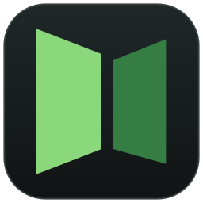

# Ferestre

Play compatible **Xbox PC and Microsoft Store games on Linux** using your Microsoft account, purchases and Game Pass subscription.

<br clear="left">

**[Download the AppImage](https://github.com/icex/ferestre/releases/download/v0.1.27/ferestre-0.1.27-x86_64.AppImage)** · [Compatible games](docs/COMPATIBILITY.md#the-matrix) · [Quick start](#quick-start) · [Report a problem](https://github.com/icex/ferestre/issues)

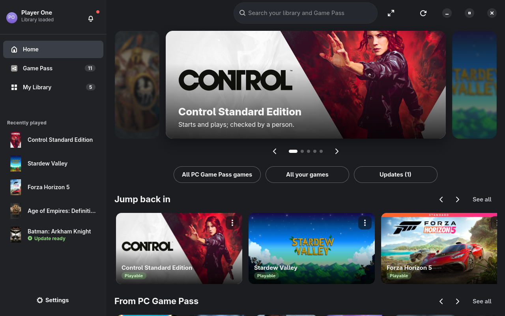

<table>
  <tr>
    <td width="50%">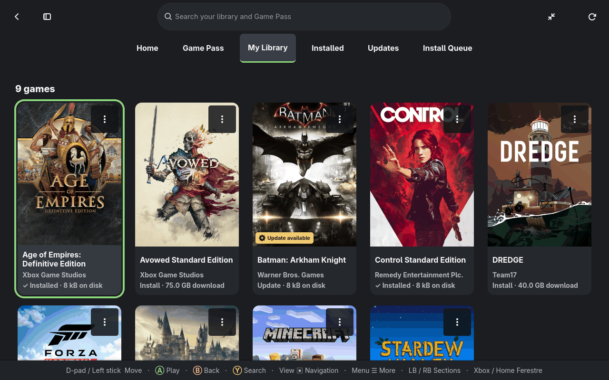<br><strong>Play from the couch with a controller</strong></td>
    <td width="50%">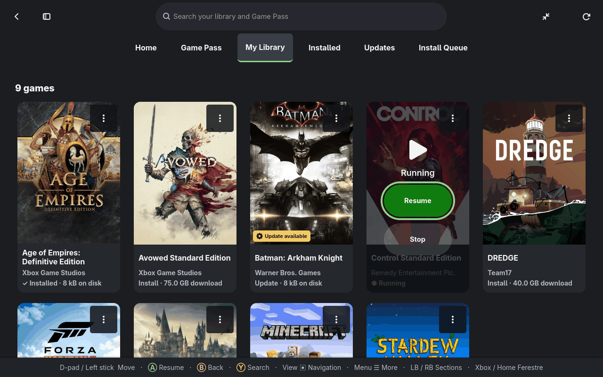<br><strong>Switch between running games</strong></td>
  </tr>
  <tr>
    <td width="50%">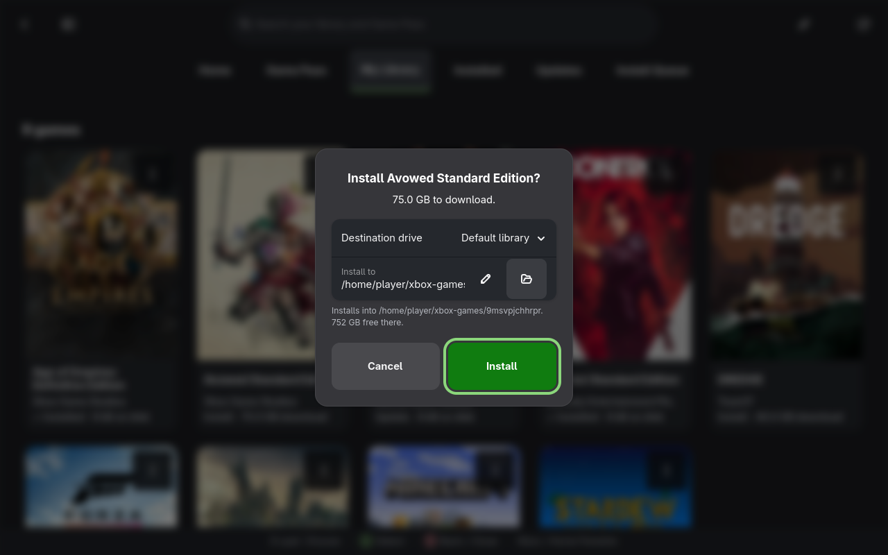<br><strong>Choose where each game installs</strong></td>
    <td width="50%">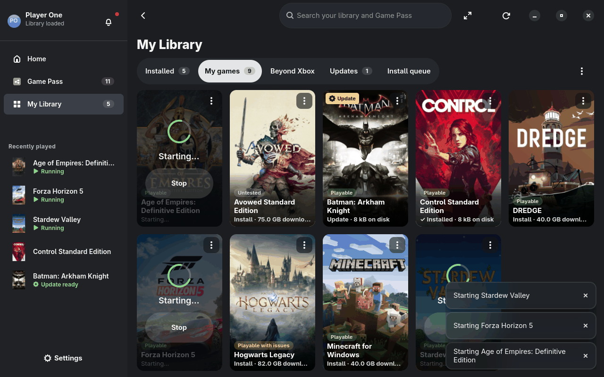<br><strong>See every result at once</strong></td>
  </tr>
  <tr>
    <td width="50%">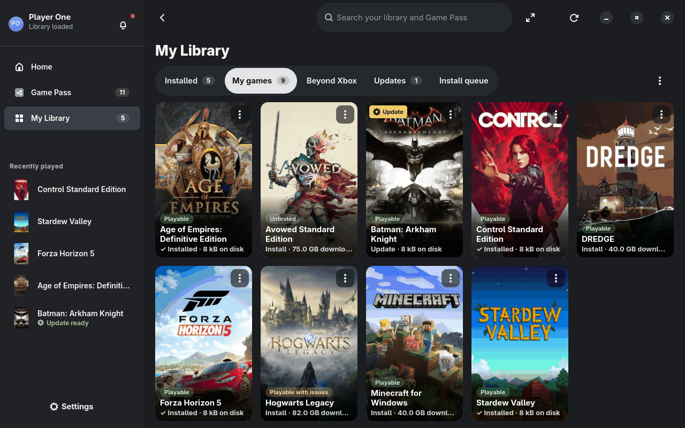<br><strong>See how well each game runs</strong></td>
    <td width="50%">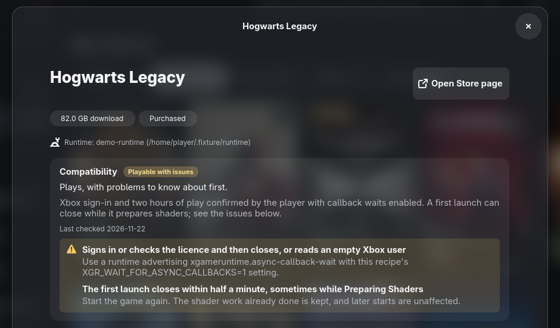<br><strong>Know the issues before you install</strong></td>
  </tr>
</table>

<details>
<summary>More screenshots: launch settings, Stop confirmation, compact sidebar, a game already running, ultrawide</summary>

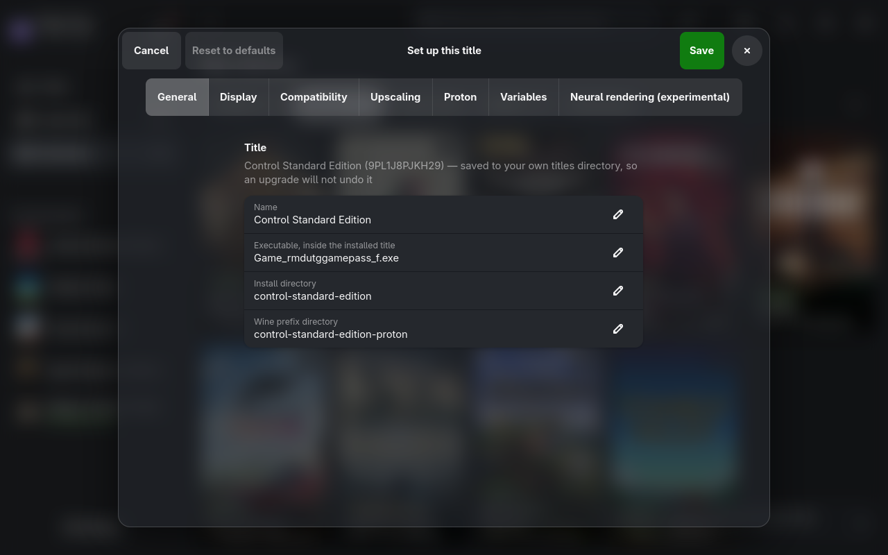

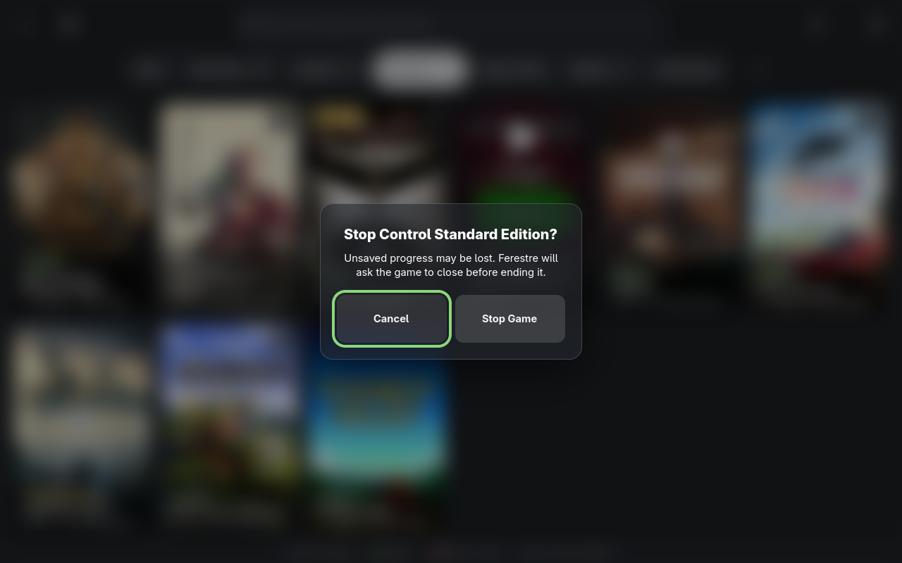

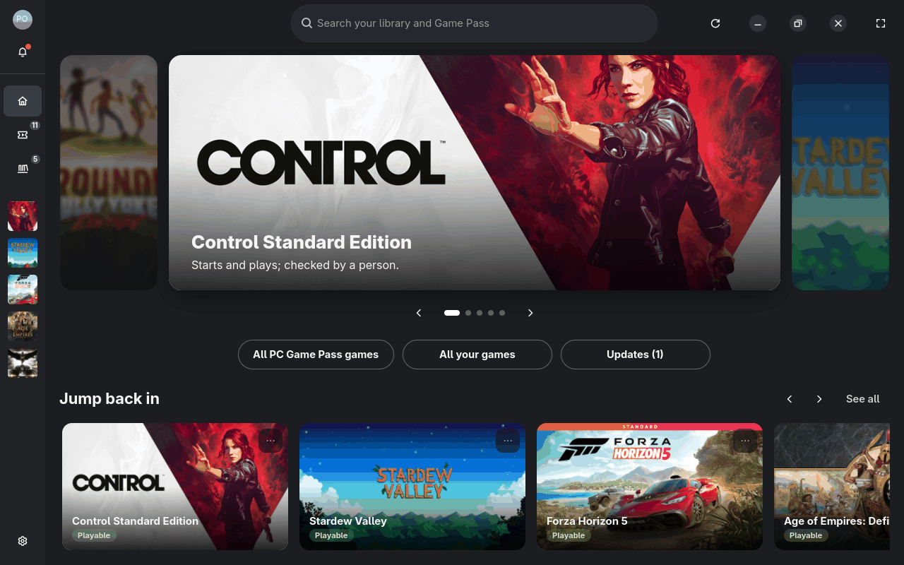

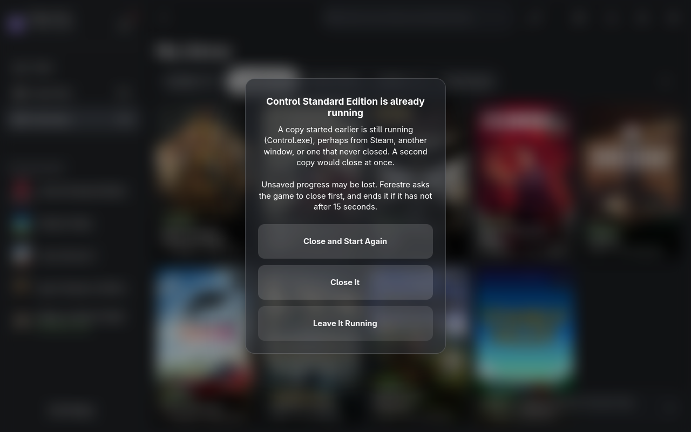

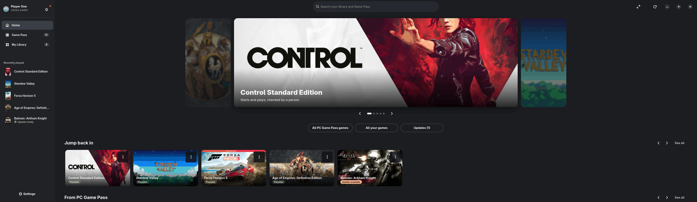

</details>

*Screenshots use a demo library and synthetic account data. `tools/readme-screenshots.py` regenerates them.*

## Quick start

### 1. Download and open Ferestre

You need **x86_64 Linux**, a Vulkan-capable GPU with working drivers, and the [host libraries](docs/DEPENDENCIES.md) used by the launcher and runtime. Steam can supply some video-playback dependencies.

Download the `.AppImage` from the [latest release](https://github.com/icex/ferestre/releases/latest). Save it as `ferestre.AppImage` to use the commands below, or substitute its downloaded filename.

```sh
chmod +x ferestre.AppImage
./ferestre.AppImage
```

You can also make it executable through your file manager's **Properties → Permissions**, then open it normally. If FUSE mounting is unavailable, run:

```sh
./ferestre.AppImage --appimage-extract-and-run
```

Arch users can use the [AUR packages](packaging/aur/README.md). For source builds, see [CONTRIBUTING.md](CONTRIBUTING.md).

### 2. Set up the runtime and sign in

Let Ferestre download its **signed runtime** when prompted. The AppImage includes the launcher and Xbox client; the Proton/GDK runtime is a separate download.

Open the profile menu and choose **Sign in**. If the sign-in window needs WebKitGTK, Ferestre offers the appropriate package installation or a command for your distribution.

In **Accounts**, choose the Microsoft account supplying purchases/Game Pass (**Store**) and the Xbox account you want to play as (**Player**). They can be the same account. See the [account guide](docs/ACCOUNTS.md) for separate accounts and saves.

### 3. Install and play

1. Open **My Library** for your account's games and local installations, or **Game Pass** to browse the current PC catalogue.
2. Choose a game, select **Install**, choose a library folder and confirm.
3. Follow progress in **My Library → Install queue**, or with the **Downloads** button in the sidebar. Choose **Play** when installation finishes.

Check the label on the game's tile (**Playable**, **Playable with issues**, **Untested** or **Not playable**) before a large download; **Game details** says what was tested and lists known issues. The [compatibility list](docs/COMPATIBILITY.md#the-matrix) has every tested game. Ferestre supports compatible **GDK/MSIXVC** games; many other Store apps use UWP/Appx/Msix formats that are currently unsupported. Game Pass access depends on your subscription, region and the title still being included. Microsoft checks the licence when installing or launching.

## Quick guides

### Find your way around

**Home** opens with a carousel of what is running, what you played last, games with updates and Game Pass titles. Below it are quick links, **Jump back in** with your installed games, and shelves of Game Pass and your library; **See all** opens the full list. The search at the top looks through your library and Game Pass.

The sidebar lists the games you played recently, last played first, with their state: Running, Update ready, Queued, Downloading and so on. To turn it into a narrow rail of icons, switch on **Compact sidebar** in **Settings → Appearance** or in the account menu. Ferestre remembers the choice.

Results such as "Starting…" or a finished install appear together in the bottom-right corner, newest at the bottom. The bell beside your account keeps this session's notifications for any you missed. Behind a dialog the window blurs; it only dims instead when your desktop turns animations off or the graphics are too slow for blur.

### Pause or resume a download

Open **My Library → Install queue** and choose **Pause** or **Resume**. The queue survives restarts and runs one transfer at a time. Resume keeps the saved destination and verified progress.

See [downloads and controls](docs/DOWNLOADS.md) for progress, reused data and recovery.

### Update a game

Open **My Library → Updates**, then choose **Update**. Ferestre updates the existing installation in its current folder. A paused update offers **Resume** and continues that update.

### Switch between games

Running game cards show **Resume** and **Stop**. Resume returns to the existing game window. Stop opens an in-app confirmation with **Cancel** selected first.

If a game is already running from somewhere else, such as a Steam shortcut, **Play** does not start a second copy. Ferestre asks instead: **Leave It Running**, **Close It**, or **Close and Start Again**. Closing asks the game to quit and ends it after 15 seconds if it has not, so unsaved progress may be lost.

Keep Ferestre open while playing to use the controller's **Xbox/Home** or **PS** button to return to the launcher. Select another game, resume one already running, or stop it from its card.

### Use a controller or handheld PC

Use the header's fullscreen button or **F11** to enter the handheld layout. Button hints adapt to Xbox and PlayStation controllers.

| Action | Xbox | PlayStation |
|---|---|---|
| Move focus | D-pad / left stick | D-pad / left stick |
| Select | A | ✕ |
| Back / cancel | B | ○ |
| Game options | Menu | Options |
| Return to Ferestre | Xbox/Home | PS |

Text entry, destination selection, installation, queues and confirmation dialogs work inside the app. PlayStation controllers need the [host SDL2 library](docs/DEPENDENCIES.md#sdl2-for-playstation-controllers).

### Update Ferestre and its runtime

Open **Settings → Check for Updates**, then use the **Update** banner. Downloads are signature-checked; a writable AppImage is replaced with a backup kept for recovery. New runtimes install alongside previous versions, and a restart waits for current work to finish.

Existing per-game runtime choices remain selected. To change one, use the game's **More actions → Edit launch settings → Proton**. **Settings → Choose default runtime** sets the default; **Use default runtime** clears a game's override. Changes apply to the next launch.

See [signed updates and rollback](docs/UPDATES.md) for supported installations. Update package-managed installations through your package manager.

### Enable HDR

Enable HDR in your desktop's display settings, install the current Ferestre runtime, then enable HDR in the game's video settings when available. Tested recipes such as Forza Horizon 6 select native Wayland HDR explicitly. Other games use XWayland for compatibility; testing native Wayland requires `FERESTRE_NATIVE_WAYLAND=1`. See [desktop integration](docs/DESKTOP-INTEGRATION.md) for details.

Choose a suitable rendering resolution in the game. The runtime includes 4K and scaled ultrawide modes and preserves the display's native refresh rate. See [desktop integration](docs/DESKTOP-INTEGRATION.md) for detection, window controls and performance helpers.

### Change a game's launch settings

Open the game's **More actions → Edit launch settings**. The tabs hold native Wayland, Gamescope, HDR, the performance profile, compatibility and upscaling switches and the runtime, each with a line saying what it does; other environment variables can be added below them. Your changes are saved as your own copy of the game's recipe. **Reset to defaults** sets that copy aside as a `.toml.bak` file and returns the game to the settings Ferestre ships or detects.

### Move a game or add it to Steam

- **Move:** open the game's **More actions → Move location**, choose an existing library folder and confirm after the space check. Ferestre verifies the move, and keeps the original if it fails or is cancelled. Saves and prefixes retain their existing locations.
- **Steam:** close Steam, then choose **Add to Steam** in the game's menu. **Add all games to Steam**, in My Library's menu, adds all installed games. Shortcuts include available artwork and retain their identity when updated.

### Play games you already have

Windows games Ferestre did not install (GOG, other stores, Steam non-Steam shortcuts) can live in the same library as **local games**:

- **Add a game:** choose **+ → Add game…** in the library and pick its `.exe`; the name and folder are filled in and can be edited. Or `./ferestre.AppImage add /path/to/Game.exe`.
- **Import from Steam:** choose **+ → Import from Steam**, or `./ferestre.AppImage import-steam --dry-run` to see what would come in, then without `--dry-run`. Each non-Steam shortcut keeps its executable, launch options (environment, wrappers such as `gamemoderun`, arguments), Wine prefix, Proton build and grid art. Steam's files are only read; Ferestre's own shortcuts are skipped.
- **Games Steam installed** come in with the same import, marked **Steam game**. **Play** asks Steam to start them, so Steam's Proton, launch options, DRM and cloud saves stay as they are. A shortcut to a script or other Linux program of your own is imported the same way, as a **Steam shortcut**; for neural rendering, set the Windows program it runs and its Wine prefix in **Edit launch settings**.

Other local games start through Ferestre's Proton shim without any Xbox service, licence or account. **Remove from library** only forgets a local game: its folder and its Wine prefix are never deleted. A local game has no **Reset to defaults**: its settings are the game. Games with anti-cheat files are flagged in the library. See [local games in recipes](titles/SCHEMA.md#local-games-user-recipes-only).

### Try neural rendering (experimental)

On an AMD Radeon RX 9000 card, a game can run NVIDIA's DLSS 5 neural rendering network through [DLSSNR-AMD](https://github.com/TheAutomatic/DLSSNR-AMD). Open **Edit launch settings → Neural rendering**, or `./ferestre.AppImage neural enable <id>`. It needs your own `nvngx_dlssnr.dll` (Ferestre ships no NVIDIA file), and in game the game's upscaler set to DLSS. **Ctrl+Y** opens the NR Control menu. Turning it off puts every replaced file back. See [Neural rendering](docs/NEURAL-RENDERING.md) for requirements, anti-cheat and troubleshooting.

### Refresh your library

Use the top-right **Refresh** button, or **Reload library** in the profile menu, after purchases or subscription changes. Lists open from cache for speed; refresh checks them again. A failed refresh retains the last complete library.

**My Library** contains account titles, local installations and transfers in progress. **Game Pass** is the separate public PC catalogue. A game leaving Game Pass can remain installed and manageable, but still needs a valid licence to play. The [compatibility list](docs/COMPATIBILITY.md#the-matrix) lists tested games independently of what your account owns.

## Troubleshooting

| Problem | Start here |
|---|---|
| Sign-in will not open | Install the WebKitGTK package offered by Ferestre; see [host dependencies](docs/DEPENDENCIES.md#webkitgtk-for-sign-in). |
| A game is missing or access is refused | Refresh the library, check the selected Store account and current Game Pass coverage. A previous subscription download does not grant permanent ownership. |
| A game will not start | Run `./ferestre.AppImage doctor`, check the game's [compatibility notes](docs/COMPATIBILITY.md#the-matrix), and select a suitable runtime in game options. |
| Videos are black or silent | Check [video-playback dependencies](docs/DEPENDENCIES.md#video-playback-with-current-runtimes). |
| Controller input is missing | Check [SDL2 dependencies](docs/DEPENDENCIES.md#sdl2-for-playstation-controllers). Steam shortcuts can use Steam Input. |
| An update needs recovery | See [update backups and rollback](docs/UPDATES.md). |

When [reporting a problem](https://github.com/icex/ferestre/issues), include the game, Ferestre/runtime versions, Linux distribution and what happened. Review logs for personal information before sharing them.

## Command line

The AppImage also accepts CLI commands:

```sh
./ferestre.AppImage doctor
./ferestre.AppImage library
./ferestre.AppImage install PRODUCT-ID
./ferestre.AppImage run PRODUCT-ID
./ferestre.AppImage add /path/to/Game.exe
./ferestre.AppImage import-steam --dry-run
./ferestre.AppImage neural status
./ferestre.AppImage updates
./ferestre.AppImage check-app-updates
```

Use `./ferestre.AppImage --help` for all commands. `run` refuses to start a game that is already running or still starting in its prefix, and exits with code 4; `run --help` lists the exit codes. The window and CLI use the same installation records and launch decisions. [Recipes and advanced setup](docs/RECIPES.md) cover custom paths and manual troubleshooting.

## Documentation and development

| Guide | Covers |
|---|---|
| [Game compatibility](docs/COMPATIBILITY.md) | Tested titles, limitations and verification dates |
| [Dependencies](docs/DEPENDENCIES.md) | Distribution-specific sign-in, graphics, video and controller libraries |
| [Downloads](docs/DOWNLOADS.md) | Install queues, pause/resume and progress |
| [Updates](docs/UPDATES.md) | Signed application/runtime updates and recovery |
| [Desktop integration](docs/DESKTOP-INTEGRATION.md) | HDR, scaling, refresh rate, window controls and performance helpers |
| [Accounts](docs/ACCOUNTS.md) | Sign-in, Store/Player selection, saves and sign-out |
| [Online presence](docs/PRESENCE.md) | What Xbox friends see while you play |
| [Neural rendering](docs/NEURAL-RENDERING.md) | Experimental DLSS 5 neural rendering on RX 9000 cards, per game |
| [Pinned source forks](docs/SOURCES.md) | Component repositories, commits and source verification |
| [Package verification](docs/PACKAGE-SIGNATURES.md) | Microsoft package signatures and download integrity |
| [Contributing](CONTRIBUTING.md) | Build, test and add game recipes |
| [Roadmap](docs/ROADMAP.md) | Current work and planned support |
| [Releasing](docs/RELEASING.md) | Release builds and signing |
| [Debugging notes](notes/) | Technical investigations |

Current releases: **[Ferestre 0.1.27](https://github.com/icex/ferestre/releases/tag/v0.1.27)** and **[runtime 11.0.20261124.1](https://github.com/icex/ferestre/releases/tag/runtime-11.0.20261124.1)**. Read the [0.1.27](docs/RELEASE-0.1.27.md) and [0.1.26](docs/RELEASE-0.1.26.md) release notes for tested scope.

## About the project

Ferestre began with a simple goal: let my son play the Windows Store version of Minecraft he already owned after moving to Linux. The launcher, catalogue and runtime support grew from that work.

It is a personal open-source project, with support as time allows. Reports, game recipes and pull requests are welcome. **Ferestre** is Romanian for **windows**, pronounced roughly *feh-RESS-treh*.

Ferestre uses a Microsoft Store/Xbox client for authentication and downloads, a Wine/Proton runtime with an implementation of the Xbox GDK, and this launcher. It signs in with your account and ships no game content. It is independent of Microsoft, Mojang, Valve and the upstream Xodus project.

## Licence

MIT for the original launcher, scripts and tests; LGPL-2.1-or-later for the Wine, xgameruntime and vkd3d-proton forks; GPL-3.0-only for the Xodus client; BSD-3-Clause for Proton's top-level components. [NOTICE](NOTICE) records component provenance and licences. The launcher invokes the client as a separate process.
