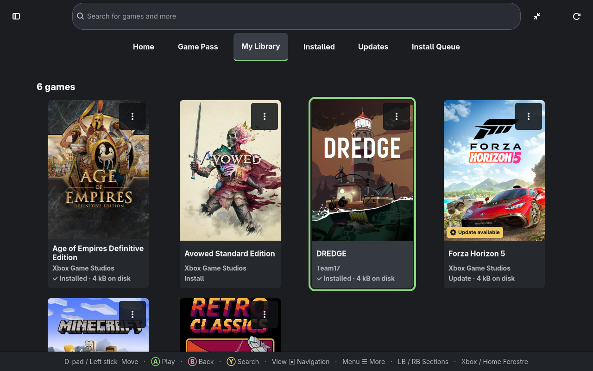
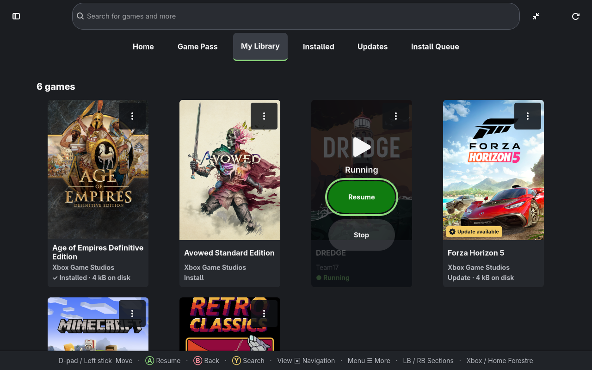
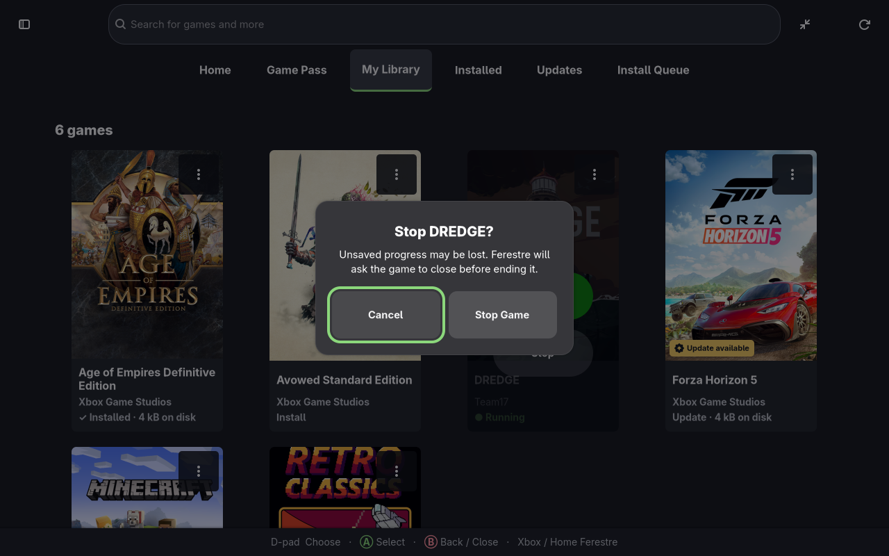
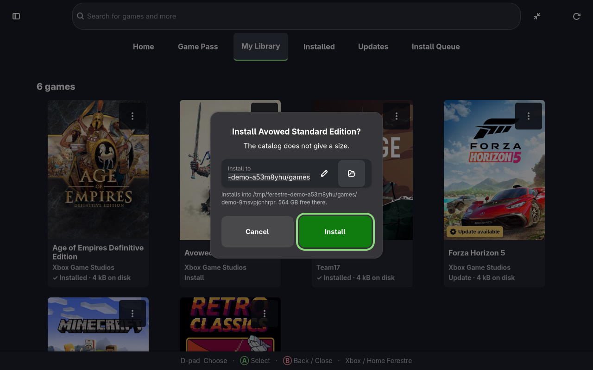

# Ferestre

Running **Xbox GDK / Microsoft Store (MSIXVC) titles on Linux**, on a patched
Wine/Proton with a from-scratch implementation of the Xbox Game Development Kit
runtime.

 

> **You need to own the games.** This project ships no game content and never
> will. It signs in with *your* Microsoft account, uses *your* licences, and
> downloads *your* purchases. If you do not own a title, or your account does
> not have a Game Pass entitlement for it, there is nothing here that will let
> you play it — and that is deliberate.

## Why

My son wanted to keep playing **Minecraft** after moving his machine from
Windows to Linux.

The usual answer is the Android build under an emulator, which is a different
game: different edition, different input, different performance, and it does not
join the servers his friends are on. The version he already owns is the Windows
Store one, and that is a `.msixvc` package — encrypted, licence-gated, and built
against the Xbox GDK, none of which Wine could open.

So the goal was narrow and specific: **let a kid play the Minecraft he already
owns, on Linux, without pretending to be a phone.** That works now, servers and
all. Everything else here — the GDK runtime, the launcher, the catalogue work —
grew out of that one requirement, and the same machinery turned out to run other
Store titles too.

## What to expect from it

This is a pet project I built for my kid over a weekend, largely vibe-coded, and
it should be read that way. It is not a product and there is no team behind it —
support is whatever my personal time allows, which some weeks is none.

That said, it works, it is public, and it is open source for a reason: **please
test it, open issues, and send pull requests.** A bug report that names a title
and says what it did is genuinely useful, and a recipe for a title that turned
out to need something unusual is the most useful thing anyone can contribute —
[CONTRIBUTING.md](CONTRIBUTING.md) covers adding one, and
[docs/RECIPES.md](docs/RECIPES.md) covers doing it by hand first. Just do not
mistake it for something with a support contract behind it.

## The name

**Ferestre** is Romanian for **windows** — the plural of *fereastră*, the thing
in a wall you look through, not the operating system. Romanian gets it from
Latin *fenestra*, the same root behind French *fenêtre*, Italian *finestra* and
the English word *defenestration*.

The joke is that this project runs Windows games, on Linux, by putting a window
around them — and that the pun only works in a language Microsoft did not name
anything after. The icon is an arched window rather than a four-pane rectangle
for the same reason: a four-pane rectangle is somebody else's trademark.

Pronounced roughly *feh-RESS-treh*.

## Application updates

The app checks for newer Ferestre and runtime releases and shows an **Update** banner. One click verifies the release signatures, updates a writable AppImage and its bundled Xbox components, installs a newer runtime beside existing versions, and restarts when current work finishes. **Settings → Check for Updates** checks manually. See [signed updates and recovery](docs/UPDATES.md) for supported installations and rollback.

## Status

The latest published launcher is **0.1.17**, paired with runtime **11.0.20261023.1**. It includes signed application/runtime updates, resumable game downloads, an install queue, game update badges and a fullscreen interface for handheld PCs. See the [0.1.17 release notes](docs/RELEASE-0.1.17.md) and [0.1.16 qualification](docs/RELEASE-0.1.16.md) for tested scope.

**Unreleased in this branch:** running games offer **Resume** to return to their window and **Stop** with a confirmation dialog. Controller text entry and folder selection stay inside Ferestre. **Settings → Choose default runtime** selects the default; **game options → Choose runtime** overrides it for one game. **Use default runtime** removes that override, and choices apply to the next launch. Paused updates resume their saved destination and package metadata directly. Transfer progress distinguishes preparation, processed data, actual game-data downloads and reused bytes. Source builds use pinned `icex` forks rather than applying patch files.

The full **[game list and compatibility notes](docs/COMPATIBILITY.md#the-matrix)** live in a separate document, generated from the title recipes. It includes Halo: The Master Chief Collection and records each title's tested scope and verification date. Downloading successfully does not establish that a game is playable.

## Screenshots

Development previews use an isolated demo library and synthetic account data.

Notes worth having before you try your own library:

- **Only MSIXVC packages.** That is the container Xbox GDK titles ship in.
  Everything else in a typical Store library is UWP (`Appx`, `Msix` and their
  bundle and encrypted variants) and this runtime cannot open it — measured on
  one real account, that is 95 of 102 owned titles. The window holds them back
  behind a switch that says how many there are and why, rather than mixing them
  in. Support for them is on the roadmap and is not a small job.
- **Game Pass lists more than any one tier grants.** The PC catalogue is
  public — 524 titles at the time of writing — but a given subscription covers a
  subset, and installing outside it is refused at the licence step. Those rows
  are filtered out by default too.

There is a launcher: a CLI (`ferestre`) and a GTK4 window (`ferestre-gui`) that
signs in, lists what your account owns with real names, cover art and download
sizes, lists what a Game Pass subscription includes, installs with a progress
bar and a time remaining, detects updates, and launches. See
[docs/ROADMAP.md](docs/ROADMAP.md) for what is still missing and
[docs/RECIPES.md](docs/RECIPES.md) for doing any of it by hand.

Install Queue saves downloads across restarts, with one active transfer at a time.
Pause and Resume keep verified progress; game updates can reuse authenticated
local pages. Touch targets and optional SDL2 controller navigation support
handheld use. See [downloads and controls](docs/DOWNLOADS.md) for details.

Active operations stay visible, and the top-right spinner's tooltip names the
current task. Closing during a download or removal asks first: downloads stop
and keep their game files for resuming, removals finish, and the window waits
for cleanup before exiting.

**Install to** chooses a library folder: each title gets its own folder inside
it, and **Remove from disk** only ever deletes that title's folder. Running cards
show **Resume** to return to the existing game window and **Stop** to open a
confirmation dialog. **Cancel** is selected first. Confirmed Stop asks the game
to close and allows 15 seconds before ending it; forcing an early stop also asks
for confirmation.

**Signed downloads.** Ferestre's own releases are signed with minisign, and
the launcher installs only runtimes signed with the project's key
([docs/RELEASING.md](docs/RELEASING.md)). Game downloads are checked page by
page against the package's hash tree, and the package header against
Microsoft's own signature, using a key the client fetches from Microsoft on
first use ([docs/PACKAGE-SIGNATURES.md](docs/PACKAGE-SIGNATURES.md)).

Two things the window is careful about, because both are easy to get wrong in a
way that looks like it works. Titles whose package this runtime cannot open --
Appx and Msix, which is most of a typical Store library -- are held back behind
a switch that says how many there are, rather than mixed in among the ones that
run. And a title being in the Game Pass catalogue is not the same as your
account being entitled to it: the window says what the catalogue includes and
which subscriptions the account holds, and lets the licence request at install
time be the thing that decides.

## Accounts, controllers and sign-in

**Store and Player accounts.** Accounts settings choose the account whose
purchases and Game Pass are used (Store) separately from the Xbox account that
plays (Player: gamertag, achievements, saves). Both are shown before launch,
each Player gets its own save prefix, and a running game keeps the pair it
started with. Splitting them needs runtime 11.0.20261018.1 or newer; older
runtimes refuse instead of launching with the wrong account. Microsoft's and
publishers' own account-sharing rules still apply. See
[docs/ACCOUNT-SHARING-PROPOSAL.md](docs/ACCOUNT-SHARING-PROPOSAL.md).

**Online status.** While a game started through Ferestre runs, from the
window, a Steam shortcut or `ferestre run`, your Xbox friends see you playing
it. Ferestre reports it with the game's own identity and reports nothing when no
game is running. It is on by default after sign-in. To turn it off for a Player
account, switch off **Show me online** in the account menu. The dot by your
name says Online or Offline, as Xbox reports it; with no game running it says
Offline. See [docs/PRESENCE.md](docs/PRESENCE.md).

**MCC campaign content.** Installing The Master Chief Collection automatically
prepares its campaign packages. Play also repairs missing content before the
game starts. Installed add-ons such as Reach show **Installed** and name their
base game; launch MCC to play them. They need no Set up step or separate prefix.

**Controllers.** Xbox pads, DualShock 4 and DualSense pads reach GDK titles
through Wine's XInput and GameInput. PlayStation pads go through SDL, which
needs the host's SDL2 (`sdl2-compat` on Arch and Fedora). From a Steam
shortcut, the shortcut's Steam Input layout applies without `--steam`, and
Steam sees the game exit when it quits.

**Sign-in needs WebKitGTK 4.1.** The Xbox client's sign-in window is a
WebKitGTK view. If it is missing, the window says so and offers to install it
through your system's package manager, or shows the command.
[docs/DEPENDENCIES.md](docs/DEPENDENCIES.md) lists what each part needs.

## How it fits together

Three layers, only one of which is unusual:

1. **The client** — signing in, fetching your licences and content keys, and
   downloading and decrypting the MSIXVC package. This is what the upstream
   [Xodus](https://github.com/xodus-gaming) project already does.
2. **The runtime** — a Proton fork whose Wine is patched so an encrypted title
   can actually be *loaded*, plus `xgameruntime.dll`: an implementation of the
   GDK (task queues, async, users, storage, networking, save games, packages)
   written against the observable behaviour of the API.
3. **The launcher** — this repository. `ferestre-core` decides everything (which
   recipe applies, whether the runtime can satisfy it, where a title installs);
   the CLI and the window are two faces on the same decisions, so they cannot
   disagree. It never links the client: Xodus is GPL-3.0-only and this is MIT,
   so the client is run as a child process — which is also the only shape that
   works, because a decrypted executable is passed to Wine as an inherited file
   descriptor.

The awkward part is that a GDK title's executable is encrypted on disk and only
ever exists decrypted inside a memfd handed to Wine, so it cannot be started
directly. Everything has to go through the client's `run` path.

## What this is not

- Not a way to play games you do not own.
- Not a piracy tool: no content, no keys, no bypass of a title's own protection.
  Where a title defends itself against running under Wine, it stays unsupported:
  the job here is to tell those checks the truth, not to defeat them.
- Not affiliated with Microsoft, Mojang, Valve, or the Xodus project.
- Not upstreamable to Xodus: they operate a clean-room policy that excludes
  AI-assisted contributions, so this stays a downstream fork.

## Library sizes and cached lists

Home uses featured artwork and recent games. My Library, Game Pass and Installed
use large cover cards with a primary action and an always-visible More menu.
Updates keeps compact version rows. More → Game details shows full metadata.
Cards show either measured disk usage for the game directory or the
Store's PC download size. Wine prefixes and cached downloads are separate from
the installed game total; unavailable sizes are labelled explicitly. Disk usage
measurements persist across restarts and list refreshes for 24 hours. Install
record, directory identity or manifest changes invalidate them; expired totals
remain visible while a background scan updates them. Changes to existing files
deep inside a game are picked up by that daily scan.

Owned games, subscription access and the public Game Pass catalogue open from
disk cache. Library/subscription lists, game-update checks, public Game Pass listings
and product details are reused for 24 hours. Switching views does not repeat
game-update queries. The top-right Refresh button forces an immediate check. Cached names and sizes appear
immediately while stale details revalidate in the background. Changing market
or language revalidates product details too. The refresh button bypasses cache
freshness, including for already named games. Account changes
invalidate cached ownership, and a detected subscription change refreshes the
Game Pass listing. Failed or interrupted refreshes preserve the last complete
snapshot. Closing during a list/account/update refresh exits immediately;
downloads still stop with cleanup, and removals finish before closing.

Add to Steam is in each game's menu, and **Add All to Steam** at the top of
the Installed list adds every installed game at once. A shortcut saves the
persistent AppImage target and the game's icon, with
portrait cover, landscape cover, hero banner and title logo when the Store
provides them. Re-adding updates the existing shortcut by launch identity or
name and retains its Steam ID, settings, play history and custom artwork.
Downloads are cached, and copied artwork lives in Steam's own `config/grid`
directory. Two games that share a name, such as two editions, get a shortcut
each. Close Steam before adding or updating a shortcut.

### Move an installed game

In a game's **More actions** menu, choose **Move location**, select an existing
library folder. Ferestre automatically shows the game's size, its new folder
and the space available. **Move** stays disabled while checking or if there
isn't enough space. The window shows
progress and offers **Cancel Move**.

The CLI does the same with `ferestre move PRODUCT-ID /path/to/library`.
`ferestre --json move PRODUCT-ID /path/to/library` checks the plan without
moving files. An existing destination is never merged or overwritten, and a
running game cannot be moved.

Across drives, Ferestre copies and verifies the files before updating the
installation record and removing the original. Cancellation or a copy failure
keeps the original installation. On one filesystem it stages hard links without
duplicating the game data. Prefixes and saved games keep their existing paths;
launches and Steam shortcuts follow the updated installation record.

## Documentation

- [Pinned source forks](docs/SOURCES.md) — component repositories, exact commits and source-build checks.

- [docs/RECIPES.md](docs/RECIPES.md) — build the runtime, sign in, download a
  title, launch it. Machine-independent; every script takes its paths from
  `XODUS_*` environment variables.
- [docs/COMPATIBILITY.md](docs/COMPATIBILITY.md) — every title that has been
  run, generated from the recipes, and how to report one.
- [docs/DEPENDENCIES.md](docs/DEPENDENCIES.md) — host libraries for video,
  controllers and sign-in, per distribution.
- [docs/PRESENCE.md](docs/PRESENCE.md) — what friends see while you play, and
  how to turn it off.
- [docs/PACKAGE-SIGNATURES.md](docs/PACKAGE-SIGNATURES.md) — how downloads are
  held to Microsoft's signature, and where the key comes from.
- [docs/ROADMAP.md](docs/ROADMAP.md) — the plan for turning this into a launcher.
- [notes/](notes/) — the debugging write-ups. Worth reading if you want to know
  *why* something is the way it is; several were genuinely hard to find.
- [CONTRIBUTING.md](CONTRIBUTING.md) — building (Rust 1.88 or newer), adding a
  title, running the tests.
- [docs/RELEASING.md](docs/RELEASING.md) — cutting a release, and the minisign
  key that signs it.

## Licence

Mixed, because the work is. MIT for the original tooling, tests, scripts and
notes; LGPL-2.1-or-later for the Wine, xgameruntime and vkd3d-proton forks; GPL-3.0-only for the Xodus client; BSD-3-Clause for Proton’s top-level components. [NOTICE](NOTICE) has the map.

One consequence worth knowing before building on this: Xodus is GPL-3.0, and it
is what signs in and downloads. A launcher that *shells out* to the `xodus-cli`
binary is aggregation and may carry any licence; one that *links* the `xodus` or
`msixvc` crates becomes GPL-3.0 itself.
