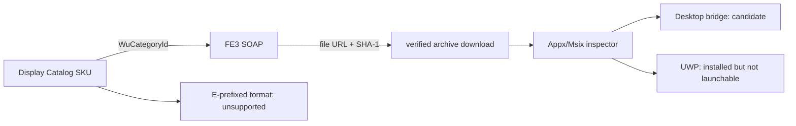

# Appx and Msix Delivery Design

## Goal

Let Ferestre identify a Store package as a desktop-bridge application or a UWP
application, then obtain an unencrypted Appx/Msix package through the Windows
Update FE3 service without treating that as proof that it can launch.

## Scope

The existing MSIXVC path remains unchanged. This design applies to `Appx`,
`AppxBundle`, `Msix`, and `MsixBundle` catalog records whose preferred PC SKU
has a `WuCategoryId`. `EAppx*` and `EMsix*` are detected and reported as
encrypted; Ferestre does not request, retain, or use their decryption metadata.

## Architecture

`ferestre-core::appx` owns container inspection. It opens an archive without
extracting it, reads only `AppxManifest.xml`, and returns the package identity,
application executable, entry point, and launch class. `DesktopBridge` means
the manifest explicitly declares `Windows.FullTrustApplication`; all other
declared entry points are `Uwp`; absent application metadata is `Unknown`.

`ferestre-core::fe3` will own protocol values and XML parsing. It accepts a
SKU-scoped category id, sends the documented FE3 SOAP sequence, and returns
only update identifiers and file locations. Its HTTP transport will trust the
Microsoft Root Certificate Authority 2011 only for the FE3 host, retaining
normal validation for every other host. The root is fetched from Microsoft's
published certificate endpoint during packaging and pinned by SHA-256 in the
source tree.

The CLI will expose inspection before delivery. A later `install` branch can
use an FE3 file location only when the response identifies an unencrypted
archive, supplies a SHA-1 digest, and the archive inspector succeeds. It will
never fall back to the MSIXVC/XVD streaming path.

## Data Flow

## Safety and Failure Behaviour

- Category identifiers are opaque data, never paths or shell arguments.
- Archive inspection has a manifest-size cap and does no extraction, preventing
  archive traversal and decompression side effects.
- The FE3 client treats malformed XML, expired cookies, missing file URLs, and
  digest mismatches as errors. A partial archive is removed.
- A successful download is not presented as runnable until the manifest declares
  a desktop bridge and a launch integration exists.
- The implementation does not handle `FileDecryption`, `FileDecryptionData`,
  or `UpdateEncryptionDetails`.

## Validation

Unit tests build small ordinary zip archives in memory and prove the inspector
distinguishes FullTrust, UWP, missing manifests, and oversized manifests. FE3
XML tests use captured, scrubbed SOAP envelopes and assert that encrypted file
metadata is rejected before any download command is constructed. A command-line
test proves `inspect-package` accepts a path and preserves JSON-only stdout.

## Sources

Microsoft documents FE3 as a SOAP update-metadata flow, with SyncUpdates
returning core metadata and extended calls providing content metadata. The
GetExtendedUpdateInfo2 contract requires a previous cookie and exposes file URL,
block map, digest, and optional decryption fields. Microsoft also publishes the
Microsoft Root Certificate Authority 2011 certificate used for Microsoft update
infrastructure. See the roadmap links and the official protocol references
captured in this work session.
